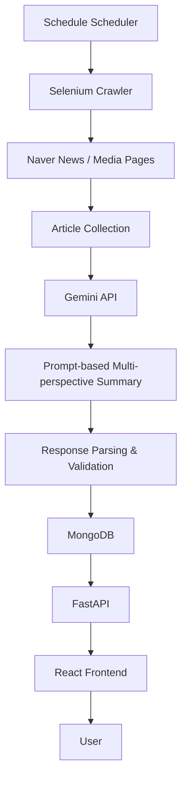

# 📰 AI 기반 다각도 뉴스 요약 서비스

> **하나의 뉴스를 여러 관점으로 바라보다.**
>
> 정치적·사회적 편향을 최소화하고, 하나의 시사 이슈를 서로 다른 관점에서 요약하여 제공하는 AI 기반 뉴스 요약 서비스입니다.  
> 다양한 시각의 정보를 접함으로써 사용자가 스스로 정보를 판단하고 균형 잡힌 시각을 형성할 수 있도록 돕습니다.

---

## 🎯 Project Overview


### 프로젝트 목적

동일한 사회·경제적 이슈라도 언론사와 기사 작성자의 관점에 따라 전달 방식과 강조점은 달라질 수 있습니다.

본 프로젝트는 이러한 정보의 차이를 사용자가 직접 비교하고 이해할 수 있도록, AI를 활용해 뉴스 기사를 서로 다른 두 가지 관점으로 요약하는 서비스를 개발하는 것을 목표로 합니다.

단순히 기사를 짧게 줄이는 것을 넘어, 하나의 이슈를 다양한 시각에서 바라볼 수 있는 정보를 제공하여 사용자의 주체적인 판단을 지원합니다.

### 핵심 가치

- **다양한 관점 제공:** 하나의 이슈를 서로 다른 시각으로 요약
- **정보 접근성 향상:** 긴 뉴스 기사를 핵심 내용 중심으로 간결하게 제공
- **자동화된 콘텐츠 수집:** 정해진 주기에 따라 최신 뉴스 자동 수집 및 요약
- **AI 기반 처리:** Gemini API를 활용한 뉴스 분석 및 요약 자동화

---

## 🛠 Tech Stack

| 구분 | 기술 | 활용 목적 |
|---|---|---|
| IDE | Cursor | AI 기반 코드 작성 및 개발 생산성 향상 |
| Backend | Python, FastAPI | REST API 및 서비스 로직 구현 |
| Crawling | Selenium, Chromium | 언론사별 최신 뉴스 수집 |
| AI | Google Gemini API | 뉴스 기사 다각도 요약 생성 |
| Scheduler | schedule | 뉴스 수집 및 요약 작업 자동 실행 |
| Database | MongoDB | 뉴스 및 AI 요약 데이터 저장 |
| Frontend | React | 뉴스 요약 결과 조회 및 사용자 인터페이스 |
| Infra | Docker | 애플리케이션 실행 환경 구성 |
| CI/CD | Jenkins | 빌드 및 배포 자동화 |
| Collaboration | GitHub, Notion, Discord | 형상 관리, 문서 관리 및 커뮤니케이션 |

---

## 🏗 System Architecture



### 데이터 처리 흐름

1. **뉴스 수집**
   - 스케줄러가 6시간 간격으로 실행됩니다.
   - Selenium과 Chromium을 활용하여 네이버 언론사별 뉴스 목록을 수집합니다.
   - 지정된 경제 분야 언론사의 최신 기사를 수집합니다.

2. **AI 기반 뉴스 요약**
   - 수집된 기사 정보를 Gemini API에 전달합니다.
   - 프롬프트 템플릿을 통해 요약 개수, 길이, 출력 형식을 제어합니다.
   - 하나의 기사에 대해 서로 다른 두 가지 관점의 요약을 생성합니다.

3. **응답 데이터 정제 및 검증**
   - Gemini 응답에 포함될 수 있는 Markdown 코드펜스와 불필요한 마커를 제거합니다.
   - JSON 파싱을 통해 정해진 데이터 구조로 변환합니다.
   - 응답 파싱 실패 시 원본 응답을 별도로 저장하여 오류 원인을 확인할 수 있도록 처리합니다.

4. **데이터베이스 저장**
   - 정제된 뉴스 요약 데이터를 MongoDB에 저장합니다.
   - 원본 기사와 요약 결과를 연결할 수 있도록 참조 URL을 함께 관리합니다.

5. **API 제공 및 프론트엔드 연동**
   - FastAPI를 통해 최신 뉴스 요약 데이터를 제공합니다.
   - React에서 API를 호출하여 사용자에게 뉴스와 두 가지 관점의 요약을 표시합니다.

---

## ⚙️ Key Features

### 1. 자동화된 뉴스 수집

Selenium 기반 크롤러를 구현하여 지정된 언론사의 최신 기사를 자동으로 수집합니다.

**수집 대상 언론사**

- 매일경제
- 한국경제
- 서울경제
- 머니투데이
- 이데일리
- 비즈워치

**주요 구현 내용**

- 네이버 언론사별 뉴스 목록 페이지 파싱
- 경제 카테고리 중심의 기사 수집
- 언론사별 최대 N개 기사 수집 (기본값: 2개)
- 6시간 주기의 자동 수집 및 처리
- Selenium + Chromium 기반 브라우저 자동화

### 2. Gemini API 기반 다각도 뉴스 요약

Google Gemini API를 활용하여 수집한 뉴스 기사를 두 가지 관점으로 요약합니다.

**주요 구현 내용**

- 프롬프트 템플릿을 활용한 출력 형식 표준화
- 요약 길이 및 관점 개수 제어
- 하나의 기사에 대한 두 가지 관점의 요약 생성
- JSON 기반 응답 파싱 및 데이터 정제
- 응답 형식 오류 발생 시 원본 데이터 별도 저장

**데이터 구조 예시**

```json
{
  "title": "뉴스 기사 제목",
  "summary": {
    "perspective_1": "첫 번째 관점에서 바라본 핵심 내용",
    "perspective_2": "두 번째 관점에서 바라본 핵심 내용"
  },
  "reference_url": "https://news.example.com/article"
}
```

### 3. MongoDB 기반 데이터 관리

수집한 기사와 AI 요약 결과를 MongoDB에 저장하고 조회할 수 있도록 구현했습니다.

- 뉴스 기사 제목 및 요약 데이터 저장
- 두 가지 관점의 요약 결과 관리
- 원본 기사 URL 관리
- 최신 뉴스 요약 데이터 조회

### 4. FastAPI 기반 API 서버

FastAPI를 활용하여 프론트엔드와 데이터베이스 사이의 API 계층을 구현했습니다.

- 최신 뉴스 요약 데이터 조회 API
- MongoDB 데이터 연동
- React 정적 파일 서빙
- 서버 실행 시 백그라운드 스케줄러 구동

---

## 🔄 Automation Pipeline

본 서비스는 뉴스 수집부터 AI 요약, 데이터 저장 및 사용자 제공까지의 과정을 자동화한 파이프라인으로 구성됩니다.

| 순서 | 처리 단계 | 주요 역할 |
|---|---|---|
| 1 | Scheduler | 6시간 간격으로 작업 실행 |
| 2 | Crawling | 언론사별 최신 기사 수집 |
| 3 | AI Processing | Gemini API를 통한 다각도 요약 |
| 4 | Data Validation | 응답 정제 및 JSON 파싱 |
| 5 | Data Storage | MongoDB에 요약 결과 저장 |
| 6 | API | 최신 요약 데이터 제공 |
| 7 | Frontend | 사용자에게 요약 결과 표시 |

---

## 💡 Development Retrospective

### Cursor IDE를 활용한 AI 협업 개발 경험

이번 프로젝트의 주요 목표 중 하나는 AI 기반 개발 도구인 Cursor IDE가 실제 프로젝트 개발 과정에서 어느 정도의 생산성 향상을 가져오는지 경험하는 것이었습니다.

단순히 AI가 코드를 생성하는 수준을 넘어, 프로젝트의 구조를 이해하고 기능을 구현하며 오류를 해결하는 과정에서 AI를 개발 협업 도구로 활용하고자 했습니다.

### 1. Cursor IDE를 선택한 이유

**AI 기반 코드 자동 완성**

- 코드 문맥을 기반으로 다음 코드 자동 추천
- 반복적인 코드 작성 시간 단축
- 여러 줄에 걸친 코드 수정 및 생성 지원

**코드베이스 문맥 이해**

- 프로젝트 전체 구조를 기반으로 코드 분석
- 기존 코드와 연관된 수정 사항 제안
- 코드 간 의존 관계 및 동작 방식 파악 지원

**AI Agent 활용**

- 자연어 명령을 통한 기능 구현
- 터미널 명령 실행 및 오류 수정 지원
- 여러 파일에 걸친 변경 작업 자동화

### 2. 실제 프로젝트에서의 활용

프로젝트의 주요 개발 단계에서 Cursor를 활용했습니다.

| 개발 단계 | AI 활용 방식 |
|---|---|
| 프로젝트 설계 | 기술 스택 및 프로젝트 구조 검토 |
| 크롤러 구현 | Selenium 기반 수집 로직 작성 지원 |
| AI 연동 | Gemini API 호출 및 프롬프트 구성 |
| 데이터 처리 | JSON 파싱 및 예외 처리 로직 작성 |
| API 개발 | FastAPI 엔드포인트 구현 |
| 오류 해결 | 에러 분석 및 수정 방향 제안 |
| 코드 개선 | 반복 코드 정리 및 구조 개선 |

### 3. 프로젝트를 통해 배운 점

**AI 도구를 활용한 개발 생산성 향상**

Cursor를 활용하면서 반복적인 코드 작성과 초기 기능 구현에 소요되는 시간을 줄일 수 있었습니다. 특히 기존 코드의 문맥을 기반으로 수정 사항을 제안받을 수 있다는 점에서 개발 속도 향상을 경험했습니다.

**AI가 생성한 코드에 대한 검증의 중요성**

AI가 생성한 코드가 항상 프로젝트의 요구사항과 일치하는 것은 아니었습니다. 실제 실행 과정에서 예상하지 못한 오류가 발생하기도 했으며, 코드의 동작 원리와 데이터 흐름을 이해하지 못하면 문제를 해결하기 어려웠습니다.

이를 통해 AI가 생성한 코드를 그대로 사용하는 것이 아니라 다음 항목을 직접 검증하는 과정이 중요하다는 점을 배웠습니다.

- 생성된 코드의 실제 동작 여부
- 기존 프로젝트 구조와의 호환성
- 예외 상황에 대한 처리 여부
- 데이터 흐름과 컴포넌트 간 의존 관계
- 유지보수 관점에서의 코드 적절성

**개발자의 역할 변화**

이번 프로젝트를 통해 AI는 개발자를 대체하는 도구라기보다 개발 과정의 반복 작업을 줄이고 문제 해결을 지원하는 협업 도구라는 점을 체감했습니다.

AI를 효과적으로 활용하기 위해서는 요구사항을 명확하게 정의하는 능력, 프로젝트 구조를 파악하는 능력, 생성된 코드의 문제점을 검증하는 역량이 함께 필요하다는 것을 배웠습니다.

---

## 📌 Project Summary

본 프로젝트는 뉴스 수집부터 AI 기반 다각도 요약, 데이터 저장, API 제공까지 이어지는 전체 데이터 처리 과정을 구현한 서비스입니다.

프로젝트를 진행하면서 다음과 같은 경험을 얻을 수 있었습니다.

- Selenium을 활용한 웹 크롤링 및 데이터 수집 자동화
- Gemini API 연동 및 프롬프트 엔지니어링
- 비정형 AI 응답의 JSON 변환 및 예외 처리
- MongoDB를 활용한 데이터 저장 및 조회
- FastAPI와 React를 활용한 서비스 연동
- Cursor IDE를 활용한 AI 협업 개발 경험

**궁극적으로 기술을 단순히 적용하는 데 그치지 않고, AI를 활용해 실제 사용자가 가치를 얻을 수 있는 서비스를 구현하는 경험을 쌓을 수 있었습니다.**
